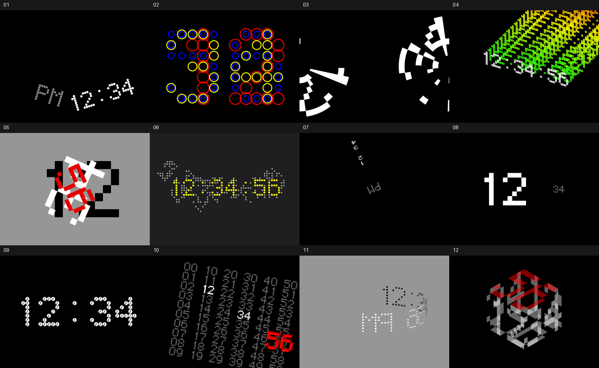
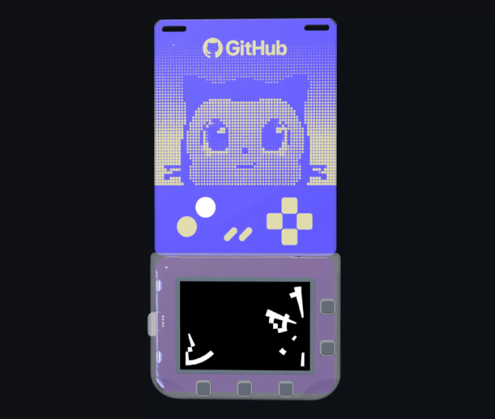

# 12 o'clocks

I made **12 o'clocks** in the 1990s. At the time, I couldn't have imagined
the journey this work would take: a community of people around Processing
and p5.js would recreate it, share it, and make it possible for me to
translate those recreations into Python decades later.

That community work matters. Golan Levin
[documented the original clocks and captured animated GIFs of all twelve](https://ems.andrew.cmu.edu/2016-60212/lectures/lecture-09-09b-clocks/maedas-clocks/index.html),
helping people see the work after its original platform became difficult
to run. The [CodingTrain/12oclocks README](https://github.com/CodingTrain/12oclocks#readme)
credits his documentation as a key resource for the community's recreation.
Daniel Shiffman and the CodingTrain contributors rebuilt the clocks in
p5.js, giving these old ideas another life in a language and an environment
that more people could explore. You can
[run their p5.js version in your browser](https://codingtrain.github.io/12oclocks/).
This repository carries that work forward as a compact MicroPython app.

Golan also [pointed out the 30th anniversary of 12 o'clocks](https://x.com/golan/status/2110125373363261755?a=ji7ZuRgg1vZGL3Ijwy4&s=20),
making this return especially meaningful. His documentation dates the work
to 1996–97; thirty years later, it is still finding new people and new
places to run.

For **GitHub Universe 2026**, I'm
[presenting with Qianqian Ye](https://reg.githubuniverse.com/flow/github/universe26/attendee-portal/page/sessioncatalog/session/1777674201455001Cr9A).
The conference badge is itself a programmable computer, with its software
and development resources in [badger/home](https://github.com/badger/home).
That computational badge offers a new home for these clocks: work from the
1990s, recreated by the community, now running on hardware people can carry
around the conference.

Seeing it reawakened like this is a reminder that a piece of software can
outlive its original platform because people care enough to pick it up
again. I made the original clocks; the community made this return possible.

Thank you to everyone who helped these clocks keep going.

— John Maeda



*Simulator captures of the twelve faces, including evolved Life and time-history states.*

## What is here

All twelve clocks run as one selectable app for the **GitHub Universe 2026
badge**. This is a MicroPython adaptation of the
[CodingTrain p5.js recreations](https://codingtrain.github.io/12oclocks/),
not the original 1990s executable or an automated, general-purpose
JavaScript-to-Python transpiler.

The app shares its font data and drawing helpers rather than carrying twelve
separate engines. Only the selected clock runs. The three Python modules are
about 26 KB; the complete app folder is about 33 KB, including documentation,
the icon, and the license. No Wi-Fi, credentials, or network connection is
needed during ordinary use.

| Control | Action |
| --- | --- |
| Left / Right | Previous / next clock |
| Menu | Open or close the list of twelve clocks |
| Up / Down | Move through the list |
| Select | Run the selected clock |
| Back | Leave the list without changing clocks |
| Home | Return to the badge launcher |

The last selected clock is remembered.

## The clocks in motion



*12 o'clocks, reawakened for the GitHub Universe 2026 badge.*

## Run it on a badge

You need a Universe 2026 badge with its matching firmware. Ordinary desktop
Python cannot run the app: the firmware provides its display, input, and
graphics APIs.

1. Clone this repository.
2. Connect the badge using a USB data cable.
3. Open the badge's **Mass Storage** app, or use the USB command below.
4. Copy the entire `twelve_clocks/` folder into the BADGER volume's `apps/`
   directory. Back up an existing installation before replacing it.
5. Eject BADGER safely. Once it restarts, find **Twelve Clocks** near the
   bottom of the launcher.

For example, on macOS:

```sh
git clone https://github.com/johnmaeda/12oclocks.git
cd 12oclocks
python3 -m pip install mpremote
mpremote devs
```

Use the badge port reported by `mpremote devs` in place of `PORT`:

```sh
mpremote connect PORT exec "import powman; powman.reset_into_msc()"
```

The serial connection drops as the badge enters disk mode; that is expected.
Wait for the BADGER volume, then:

```sh
cp -R twelve_clocks /Volumes/BADGER/apps/
diskutil eject /Volumes/BADGER
mpremote devs
mpremote connect PORT reset
```

Rediscover the port after ejecting: its name can change. Do not copy the app
to an `RP2350` bootloader volume, and do not run concurrent serial commands.

Some stock firmware menus do not display custom app icons. The app still
runs, but the tile uses a generic icon until the
[menu icon patch](https://github.com/badger/home/blob/main/hardware/USB_SERIAL.md#menu-icon-patch)
is applied. See the same guide for the full USB workflow.

### Set the time

The clocks read the badge's internal RTC as-is, without changing its timezone.
If you see **"RTC unset: use Clock app"**, the badge's date has not been set.
You do not need to install another clock app: while the badge is in normal
serial mode, set it to your computer's local time over USB:

```sh
mpremote devs
mpremote connect PORT rtc --set
mpremote connect PORT rtc
mpremote connect PORT reset
```

Then reopen Twelve Clocks. USB time-setting was checked on a physical badge,
including retention across a reboot. This is not automatic synchronization:
repeat it if the badge loses its time or you need to change timezone.

## How the port works

```text
twelve_clocks/
  __init__.py     Launcher, controls, saved selection, and timing
  clockwork.py    Original fonts, animation timing, bounded history, and Life
  faces.py        The twelve native vector renderers
  icon.png       Badge launcher icon
tests/           Host-side regression tests
tools/           Dependency-free icon generator
```

The original dot font and polygon vertices are shared across the faces.
Animation is elapsed-time based. The Life clock keeps its 63x30 finite board
in two bytearrays, using 3,780 payload bytes. History reconstruction is
bounded to 25 samples. The miniature clocks share one rendered tile, and the
rotated grid caches its background only while that face is active.

See the [port notes](twelve_clocks/README.md) for each clock's behavior,
small-screen adaptations, resource limits, and hardware checklist.

## Development and verification

The host tests use standard-library stubs for the badge APIs:

```sh
python3 -m unittest discover -s tests -p 'test_twelve_clocks.py'
python3 tools/build_twelve_clocks_icon.py
```

The port passed 17 host regression tests, an ARM MicroPython cross-compile
of the native Life function, and rendering checks for all twelve faces in
the Universe 2026 MicroPython WASM simulator. Simulator checks also covered
rollovers, animation, navigation, saved selection, and inverted controls.

The app has been installed on a physical Universe 2026 badge, where its
launcher icon and running pendulum clock were visually confirmed. That is
not a claim that every face has completed a full hardware test: physical
frame rates, total heap headroom, long-running stability, and power use
remain to be measured. Skipping unchanged drawing does not mean the badge
is asleep.

## Credits and source

- Original **12 o'clocks** artworks: John Maeda, 1990s.
- Documentation and animated captures of the original clocks: [Golan Levin](https://ems.andrew.cmu.edu/2016-60212/lectures/lecture-09-09b-clocks/maedas-clocks/index.html), credited as a key resource in the CodingTrain README.
- Community p5.js recreations: Daniel Shiffman and the [CodingTrain contributors](https://github.com/CodingTrain/12oclocks). [Run the clocks online](https://codingtrain.github.io/12oclocks/).
- MicroPython badge adaptation: John Maeda, developed with GitHub Copilot.

This port follows
[`CodingTrain/12oclocks` at `170fb6f`](https://github.com/CodingTrain/12oclocks/tree/170fb6ff31ed93fe07c82974a918eb790be24b9e):
the twelve clock sketches, `resources/font.js`, and
`resources/font_shapes.js`. The original font data is covered by regression
tests against that pinned revision.

The badge version was first developed in
[`badger/home`](https://github.com/badger/home), then extracted here as a
standalone repository.

## License

[MIT](LICENSE). The upstream copyright notice for Daniel Shiffman (2017)
is preserved, including a copy inside the deployable app folder.
